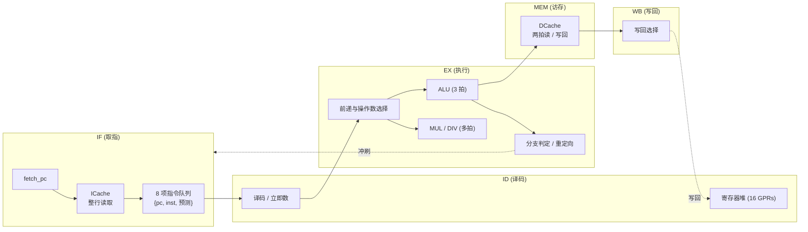

# RISC-V 处理器架构与性能报告（频率优化）

本文档记录处理器核 **`cpu_top`** 的微架构、存储层次以及经典基准测试的实测数据。所有仿真、测试与基准测试均在仓库自带的 Docker 环境中执行。

---

## 目录
- [一、处理器微架构 (Microarchitecture)](#一处理器微架构-microarchitecture)
  - [1.1 流水线与总体结构](#11-流水线与总体结构)
  - [1.2 取指、分支预测与指令队列](#12-取指分支预测与指令队列)
  - [1.3 执行单元 (ALU 与 MDU)](#13-执行单元-alu-与-mdu)
  - [1.4 存储层次与访存](#14-存储层次与访存)
  - [1.5 冒险处理与流水控制](#15-冒险处理与流水控制)
- [二、基准测试实测性能数据 (Baseline Benchmark Results)](#二基准测试实测性能数据-baseline-benchmark-results)
  - [2.1 测试总览与性能汇总表](#21-测试总览与性能汇总表)
  - [2.2 CoreMark 综合跑分测试](#22-coremark-综合跑分测试)
  - [2.3 Dhrystone 经典算力测试](#23-dhrystone-经典算力测试)
  - [2.4 MicroBench 经典算法套件测试](#24-microbench-经典算法套件测试)
  - [2.5 Thread-OS 多任务上下文切换测试](#25-thread-os-多任务上下文切换测试)
  - [2.6 Nanos-lite 操作系统运行 Navy-apps 测试](#26-nanos-lite-操作系统运行-navy-apps-测试)
  - [2.7 cpu-tests 指令全集单元测试 (37/37)](#27-cpu-tests-指令全集单元测试-3737)
- [三、功能验证 (Verification)](#三功能验证-verification)
- [四、源码结构](#四源码结构)

---

## 一、处理器微架构 (Microarchitecture)

### 1.1 流水线与总体结构

处理器为按序单发射的 5 级流水线，分为 **IF（取指）**、**ID（译码）**、**EX（执行）**、**MEM（访存）**、**WB（写回）** 五个阶段，流水线寄存器为 IF/ID、ID/EX、EX/MEM、MEM/WB。

- **指令集**：RV32E / RV32I 基础整数指令集，集成 RV32M 乘除法扩展；支持机器模式 CSR 与精准异常自陷。
- **可变延迟执行**：EX 级的 ALU 固定占用 3 拍，MUL/DIV 占用多拍；MEM 级的访存延迟由 Cache 命中或缺失决定。EX 或 MEM 未完成时，ID 级及其上游保持停顿。
- **解耦取指**：取指单元以 16 字节整行为单位读取 ICache，结果进入 8 项指令队列；ID 级从队列头部取指，取指延迟由队列吸收，不直接出现在 ID 的时序路径上。



### 1.2 取指、分支预测与指令队列

- **取指请求**：`fetch_pc` 向 ICache 请求一个 16 字节行；当队列占用不超过 3 项（即至少能容纳 4 个字）且 ICache 空闲时发起下一次请求。
- **指令队列**：行数据返回后，从目标字开始把 4 个字连同各自的预测信息写入 8 项环形队列（3 位读写指针、4 位计数）。队列头单独寄存，ID 级直接读取队头寄存器，不经过 8:1 选择。
- **分支预测单元 (BPU)**：16 项直接映射 BTB（tag、目标、返回标记）、16 项 2 位饱和计数器 BHT、8 项 RAS。查询按三拍流水组织：
  1. 请求拍：四路 PC 的索引与标签分别寄存；
  2. 阵列读拍：每个通道只用自己的索引副本读出 BTB/BHT；
  3. 比较拍：命中、计数器方向和 RAS 栈顶（寄存的 `ras_target_r`）组合出预测结果。
- **预测使用**：一次行请求同时查询该行的 4 个字，预测结果随指令入队；ID 级对预译码为控制指令的队头，若预测跳转则修改 `fetch_pc` 并清空队列。
- **预测更新**：分支、`jal`、`jalr` 在 EX 级得到实际结果，训练 BTB/BHT/RAS 并记录预测正确率；预测错误时向取指单元发出重定向并冲刷队列。

### 1.3 执行单元 (ALU 与 MDU)

- **ALU（3 拍）**：
  1. 启动拍：锁存经前递选择的操作数、操作码独热码，以及分支比较专用的 `cmp_a`/`cmp_b`；
  2. 计算拍：并行完成加法、移位与比较；
  3. 选择拍：按独热码用 AND-OR 选择最终结果，并置位 `done`。
- **加法器**：`add32cs` 把 32 位加法拆成四个 8 位加法组，组和同时计算进位输入为 0 与 1 的两种结果，再用两级选择得到组间进位，缩短进位链。64 位与 16 位取反同样由 `add16cs` 的分组进位选择实现。
- **移位器**：三级 4:1 桶形移位器（`shamt[1:0]`、`shamt[3:2]`、`shamt[4]`），左移、逻辑右移、算术右移共用移位网络，结果按操作码选择。
- **分支与跳转目标**：ID/EX 寄存器保存 `pc+4`；分支与 `jal` 的目标由该寄存器加立即数得到，`jalr` 的目标来自已寄存的操作数。重定向目标用独热码 AND-OR 选择。
- **MDU**：乘除法器为独立多周期单元，与 ALU 并行存在，由操作码选择启用。
  - 除法器：restoring 算法，`DIV_BITS_PER_CYCLE = 1`（每拍 1 位商，32 次迭代，约 35 拍）；33 位部分余数的比较/减法使用 `add32cs`，符号转换使用 `add16cs`。
  - 乘法器：radix-4 Booth 数字生成，`MUL_BITS_PER_CYCLE = 4`（每拍 4 位，8 次迭代）；部分积在进位保存（carry-save）累加器中压缩，最后单独一拍做进位传播加法；64 位符号修正按高低 32 位分别用进位选择取反。
  - **握手**：ALU、除法器、乘法器各自输出 `done`，接受信号互相门控（同一拍只允许一个单元完成并提交结果），避免多单元同时结束导致的重启竞争。

### 1.4 存储层次与访存

- **ICache / DCache 规格**：均为 2 路组相联、64 组、16 字节行（每路 1 KB，总容量 2 KB）。数组按 8 个 bank × 8 组组织，每 bank 独立读出后再选择。
- **两拍读**：请求拍把组索引按 bank 复制到 8 个寄存器；下一拍各 bank 并行读出候选行、标签、有效位与 LRU；比较拍选出目标 bank 并完成标签比较，响应寄存后输出。
- **标签比较拆分**：bank 读拍先比较标签低位一半并寄存，比较拍只比较高位一半，避免同一拍同时承担阵列读和完整标签比较。
- **写端口**：refill、store 命中、fence 清除三类写入均由寄存的独热码驱动，每拍只对一个组写入，避免 64 选 1 写译码进入关键路径。
- **DCache**：写回、写分配。store 命中在比较拍完成字节/半字合并；store 缺失时先写回脏块，再整行 refill 并合并待写数据。load 数据在 MEM 级完成符号/零扩展。
- **fence.i**：逐 bank 扫描 DCache，写回所有脏行并清除有效位，随后清空 ICache。
- **总线**：DCache 优先级高于 ICache 的仲裁器连接 AXI4 Master；ICache refill、DCache refill 与脏行写回均为 `arlen=3` / `awlen=3` 的 4 拍 INCR 突发。MMIO 访问绕过 Cache 直通总线。

### 1.5 冒险处理与流水控制

- **前递**：EX 级操作数来自 ID/EX 寄存器、EX/MEM 结果或 MEM/WB 写回数据的三选一；寄存器堆采用写透设计，WB 与 ID 同拍读写同一寄存器时直接透传。
- **Load-Use**：检测到 EX 级为 load 且 ID 级立即使用其目的寄存器时，冻结 PC、IF/ID 与队列，并向 ID/EX 注入气泡。
- **多周期停顿**：ALU、MUL、DIV 未完成，或 MEM 等待 DCache 响应、等待 fence 完成时，`id_stall` 保持 ID 及上游不动，取指队列继续填充。
- **控制流冲刷**：分支预测错误、异常/自陷、`mret`、`fence.i` 都会清空 IF/ID 与指令队列并重定向 `fetch_pc`；EX 级重定向先寄存一拍再作用于取指单元。

---

## 二、基准测试实测性能数据 (Baseline Benchmark Results)

> **说明**：所有基准测试与仿真验证均在 Docker 容器内运行；下文的运行命令均为在容器工程根目录下直接执行的命令。

### 2.1 测试总览与性能汇总表

| 测试用例 (Benchmark) | 运行规模 / 参数 | 验证状态 | 总周期数 (Cycles) | 总指令数 (Insts) | 平均 IPC | 运行时间 | ICache 命中率 | DCache 命中率 | 分支预测准确率 (BPU) |
| :--- | :--- | :--- | :--- | :--- | :--- | :--- | :--- | :--- | :--- |
| **CoreMark** | 10 iterations | **PASS** | 39,511,720 | 7,834,824 | **0.1983** | **71.85 ms** | **99.56%** | **99.92%** | **75.56%** |
| **Dhrystone** | 5,000 runs | **PASS** | 12,104,525 | 2,515,768 | **0.2078** | **22.01 ms** | **99.04%** | **96.71%** | **81.34%** |
| **MicroBench** | `test` 算法集 (10项) | **PASS** | 2,660,561 | 525,429 | **0.1975** | **4.84 ms** | **97.77%** | **94.66%** | **73.36%** |
| **Nanos-lite (`/bin/hello`)** | OS 启动 + 加载用户程序 | **PASS** | 1,208,133 | 247,111 | **0.2045** | **2.20 ms** | **97.65%** | **96.17%** | **88.40%** |
| **Nanos-lite (`/bin/dummy`)** | OS 启动 + 基础自测 | **PASS** | 918,131 | 192,188 | **0.2093** | **1.67 ms** | **98.30%** | **95.60%** | **86.14%** |
| **Thread-OS** | 20 次线程上下文切换 | **PASS** | 691,003 | 117,959 | **0.1707** | **1.26 ms** | **97.92%** | **99.44%** | **92.77%** |
| **cpu-tests** | 完整 RV32 基础指令算法 | **37/37 符合预期** | — | — | — | — | — | — | — |

> **运行时间计算**：运行时间 = 总周期数 ÷ 工作频率；工作频率取 **550 MHz**（时钟周期 1.818 ns）。

### 2.2 CoreMark 综合跑分测试

- **测试目标**：业界权威的嵌入式 CPU 整数流水线性能基准测试。
- **运行命令**：
  ```bash
  make -C am-kernels/benchmarks/coremark run ARCH=riscv32e-npc ITERATIONS=10
  ```
- **执行日志与统计输出**：
  ```text
  Running CoreMark for 10 iterations
  CoreMark PASS       4294967 Marks
  npc: HIT GOOD TRAP at pc = 0x80002580
  ================ PERFORMANCE STATISTICS ================
  Total Cycles       : 39511720
  Total Instructions : 7834824
  IPC                : 0.1983
  ICache Hits        : 15916110, Misses: 70415, Hit Rate: 99.56%
  DCache Hits        : 1117563, Misses: 850, Hit Rate: 99.92%
  Branch Prediction  : 1762837 / 2332942, Accuracy: 75.56%
  ========================================================
  ```
- **运行时间**：39,511,720 cycles ÷ 550 MHz ≈ **71.85 ms**。

---

### 2.3 Dhrystone 经典算力测试

- **测试目标**：经典整数算力性能基准测试。
- **运行命令**：
  ```bash
  make -C am-kernels/benchmarks/dhrystone run ARCH=riscv32e-npc NUMBER_OF_RUNS=5000
  ```
- **执行日志与统计输出**：
  ```text
  Dhrystone Benchmark, Version C, Version 2.2
  Trying 5000 runs through Dhrystone.
  Dhrystone PASS         0 Marks
  npc: HIT GOOD TRAP at pc = 0x80000c34
  ================ PERFORMANCE STATISTICS ================
  Total Cycles       : 12104525
  Total Instructions : 2515768
  IPC                : 0.2078
  ICache Hits        : 4357189, Misses: 42020, Hit Rate: 99.04%
  DCache Hits        : 883681, Misses: 30100, Hit Rate: 96.71%
  Branch Prediction  : 416936 / 512559, Accuracy: 81.34%
  ========================================================
  ```
- **运行时间**：12,104,525 cycles ÷ 550 MHz ≈ **22.01 ms**。

---

### 2.4 MicroBench 经典算法套件测试

- **测试目标**：测试处理器对 10 种典型算法场景的计算与访存适应能力。
- **运行命令**：
  ```bash
  make -C am-kernels/benchmarks/microbench run ARCH=riscv32e-npc mainargs=test
  ```
- **执行日志与统计输出**：
  ```text
  MicroBench PASS
  npc: HIT GOOD TRAP at pc = 0x800057c0
  ================ PERFORMANCE STATISTICS ================
  Total Cycles       : 2660561
  Total Instructions : 525429
  IPC                : 0.1975
  ICache Hits        : 937019, Misses: 21416, Hit Rate: 97.77%
  DCache Hits        : 111635, Misses: 6295, Hit Rate: 94.66%
  Branch Prediction  : 90760 / 123723, Accuracy: 73.36%
  ========================================================
  ```
- **运行时间**：2,660,561 cycles ÷ 550 MHz ≈ **4.84 ms**。

---

### 2.5 Thread-OS 多任务上下文切换测试

- **测试目标**：评估处理器在密集自陷与跨线程寄存器保存/恢复时的稳定性与缓存效率。
- **运行命令**：
  ```bash
  make -C am-kernels/kernels/thread-os run ARCH=riscv32e-npc
  ```
- **执行日志与统计输出**：
  ```text
  Thread-OS PASS (20 Context Switches Completed)
  npc: HIT GOOD TRAP at pc = 0x800002c8
  ================ PERFORMANCE STATISTICS ================
  Total Cycles       : 691003
  Total Instructions : 117959
  IPC                : 0.1707
  ICache Hits        : 228454, Misses: 4844, Hit Rate: 97.92%
  DCache Hits        : 65413, Misses: 370, Hit Rate: 99.44%
  Branch Prediction  : 22436 / 24184, Accuracy: 92.77%
  ========================================================
  ```
- **运行时间**：691,003 cycles ÷ 550 MHz ≈ **1.26 ms**。

---

### 2.6 Nanos-lite 操作系统运行 Navy-apps 测试

- **测试目标**：验证操作系统内核初始化、VFS 解析 ramdisk、ELF 用户程序加载、`fence.i` 缓存冲刷与用户态系统调用。
- **运行命令**：
  ```bash
  make -C nanos-lite run ARCH=riscv32e-npc
  ```
- **执行输出 (`/bin/hello`)**：
  ```text
  Hello World!
  Hello World from Navy-apps for the 2th time!
  Hello World from Navy-apps for the 3th time!
  Hello World from Navy-apps for the 4th time!
  Hello World from Navy-apps for the 5th time!
  npc: HIT GOOD TRAP at pc = 0x80000d50
  ================ PERFORMANCE STATISTICS ================
  Total Cycles       : 1208133
  Total Instructions : 247111
  IPC                : 0.2045
  ICache Hits        : 410690, Misses: 9883, Hit Rate: 97.65%
  DCache Hits        : 94792, Misses: 3780, Hit Rate: 96.17%
  Branch Prediction  : 48911 / 55332, Accuracy: 88.40%
  ========================================================
  ```
- **运行时间 (`/bin/hello`)**：1,208,133 cycles ÷ 550 MHz ≈ **2.20 ms**。
- **执行输出 (`/bin/dummy`)**：
  ```text
  npc: HIT GOOD TRAP at pc = 0x80000d50
  ================ PERFORMANCE STATISTICS ================
  Total Cycles       : 918131
  Total Instructions : 192188
  IPC                : 0.2093
  ICache Hits        : 328715, Misses: 5685, Hit Rate: 98.30%
  DCache Hits        : 71525, Misses: 3294, Hit Rate: 95.60%
  Branch Prediction  : 34483 / 40031, Accuracy: 86.14%
  ========================================================
  ```
- **运行时间 (`/bin/dummy`)**：918,131 cycles ÷ 550 MHz ≈ **1.67 ms**。

---

### 2.7 cpu-tests 指令全集单元测试 (37/37)

- **测试目标**：验证 RV32E 基础整数指令集与乘除法扩展在流水线、前递网络与多周期执行单元中的功能正确性。
- **运行命令**：
  ```bash
  make -C am-kernels/tests/cpu-tests run ARCH=riscv32e-npc
  ```
- **测试覆盖与实测结果**：37 个用例中 36 个 PASS，`wrong` 为负向用例，按设计触发 BAD TRAP（`a0 = 1`）；测试 Makefile 判定失败时显式排除该用例，整套测试为 **37/37 符合预期**，全部运行均启用 DiffTest。

---

## 三、功能验证 (Verification)

- **差分测试**：所有基准与测试运行均启用 NEMU DiffTest，逐指令比对 GPR 与 PC。
- **四值仿真**：`make test-4state-all` 在 Icarus Verilog 中运行全部 37 个用例，36 个 HIT GOOD TRAP，`wrong` 按预期 HIT BAD TRAP（`a0 = 1`），无 X 态导致的挂起，退出码 0。

---

## 四、源码结构

| 文件 | 说明 |
| :--- | :--- |
| [cpu_top.v](../../npc/vsrc/cpu_top.v) | 流水线、取指队列、冒险控制、CSR/自陷与总线接口 |
| [icache.v](../../npc/vsrc/icache.v) | 2 路组相联 ICache，分行读取与 refill |
| [dcache.v](../../npc/vsrc/dcache.v) | 2 路写回 DCache，store 合并、脏块写回与 fence |
| [alu.v](../../npc/vsrc/alu.v) | 3 拍 ALU：加法、移位、比较与结果选择 |
| [mul_unit.v](../../npc/vsrc/mul_unit.v) | radix-4 Booth 乘法器 |
| [div_unit.v](../../npc/vsrc/div_unit.v) | restoring 除法器 |
| [bpu.v](../../npc/vsrc/bpu.v) | BTB + BHT + RAS 分支预测单元 |
| [add16cs.v](../../npc/vsrc/add16cs.v) / [add32cs.v](../../npc/vsrc/add32cs.v) | 分组进位选择加法器 |
| [csr.v](../../npc/vsrc/csr.v) | CSR 寄存器与自陷现场 |
| [cache_arbiter.v](../../npc/vsrc/cache_arbiter.v) | ICache/DCache 总线仲裁 |
| [axi_master.v](../../npc/vsrc/axi_master.v) | AXI4 Master 接口 |
| [regfile.v](../../npc/vsrc/regfile.v) | 16 × 32 位寄存器堆（写透） |
