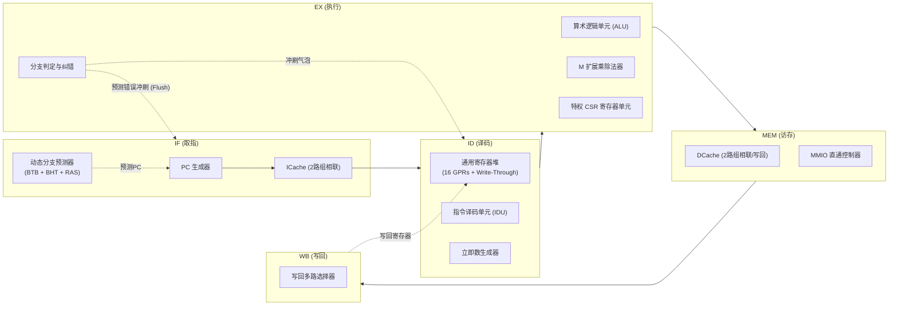
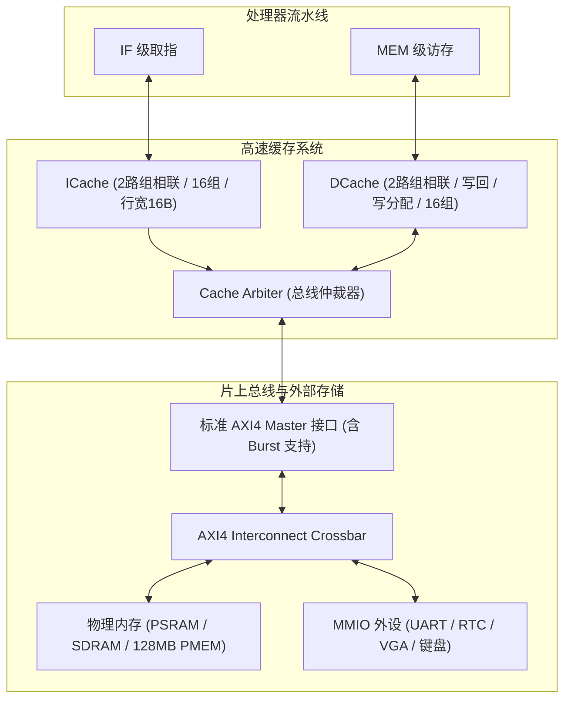

# RISC-V 处理器架构设计与基准测试基线报告 (Baseline Report)

本文档详细记录了自主研发的 5 级流水线 RISC-V 处理器核 **`cpu_top`**（基线版本 `v1.0.0`）的整体微架构规格、存储与缓存体系、外设总线互联接口、系统软件支持以及各项经典基准测试（Benchmark）的实测性能基线数据。

---

## 目录
- [一、处理器微架构规格 (Microarchitecture)](#一处理器微架构规格-microarchitecture)
  - [1.1 总体架构与流水线划分](#11-总体架构与流水线划分)
  - [1.2 数据冒险与旁路前递网络 (Forwarding Unit)](#12-数据冒险与旁路前递网络-forwarding-unit)
  - [1.3 Load-Use 冒险检测与气泡控制 (Stall Unit)](#13-load-use-冒险检测与气泡控制-stall-unit)
  - [1.4 动态分支预测单元 (BPU: BTB + BHT + RAS)](#14-动态分支预测单元-bpu-btb--bht--ras)
  - [1.5 特权架构与精准异常自陷 (CTE & CSR)](#15-特权架构与精准异常自陷-cte--csr)
- [二、存储与缓存层次结构 (Memory & Cache Hierarchy)](#二存储与缓存层次结构-memory--cache-hierarchy)
  - [2.1 指令高速缓存 (ICache)](#21-指令高速缓存-icache)
  - [2.2 数据高速缓存 (DCache)](#22-数据高速缓存-dcache)
  - [2.3 缓存一致性与 fence.i](#23-缓存一致性与-fencei)
  - [2.4 总线仲裁器与 AXI4 突发传输](#24-总线仲裁器与-axi4-突发传输)
- [三、系统软件与运行环境 (Software & OS Support)](#三系统软件与运行环境-software--os-support)
  - [3.1 NEMU 黄金参考模型与 DiffTest 差分框架](#31-nemu-黄金参考模型与-difftest-差分框架)
  - [3.2 抽象机 AM 与运行库 klib](#32-抽象机-am-与运行库-klib)
  - [3.3 简易操作系统 Nanos-lite 与用户程序 Navy-apps](#33-简易操作系统-nanos-lite-与用户程序-navy-apps)
  - [3.4 多任务协程与线程调度操作系统 (Thread-OS / Yield-OS)](#34-多任务协程与线程调度操作系统-thread-os--yield-os)
- [四、基准测试实测性能数据 (Baseline Benchmark Results)](#四基准测试实测性能数据-baseline-benchmark-results)
  - [4.1 测试总览与性能汇总表](#41-测试总览与性能汇总表)
  - [4.2 CoreMark 综合跑分测试](#42-coremark-综合跑分测试)
  - [4.3 Dhrystone 经典算力测试](#43-dhrystone-经典算力测试)
  - [4.4 MicroBench 经典算法套件测试](#44-microbench-经典算法套件测试)
  - [4.5 Thread-OS 多任务上下文切换测试](#45-thread-os-多任务上下文切换测试)
  - [4.6 Nanos-lite 操作系统运行 Navy-apps 测试](#46-nanos-lite-操作系统运行-navy-apps-测试)
  - [4.7 cpu-tests 指令全集单元测试 (35/35)](#47-cpu-tests-指令全集单元测试-3535)
- [六、源码结构与关键模块索引](#六源码结构与关键模块索引)

> 物理实现、PDK、综合、P&R 与 STA 说明见 [工具链基线](../toolchain/baseline.md)。

---

## 一、处理器微架构规格 (Microarchitecture)

### 1.1 总体架构与流水线划分

处理器核心采用经工业验证的经典 **5 级按序单发射流水线结构 (In-Order 5-Stage Pipeline)**，分为 **IF (取指)**、**ID (译码)**、**EX (执行)**、**MEM (访存)**、**WB (写回)** 五个阶段。



- **指令集 (ISA)**：RV32E / RV32I 基础整数指令集，完整集成 RV32M 乘除法扩展，支持标准特权架构 CSR 与自陷指令。
- **寄存器堆**：RV32E 架构 16 个 32-bit 通用寄存器（`x0`-`x15`），`x0` 硬件恒零；采用单周期写透（Write-Through）设计，写优先于读，避免同周期读写冲突。

### 1.2 数据冒险与旁路前递网络 (Forwarding Unit)
针对连续指令间的 **写后读 (RAW, Read-After-Write)** 数据依赖，设计了全硬件前递网络：
1. **EX/MEM $\to$ ID/EX 前递**：将上周期 EX 级计算结果在尚未写回寄存器堆时，直接短路送入当前 EX 级的 ALU 操作数输入端口。
2. **MEM/WB $\to$ ID/EX 前递**：将两周期前指令的写回数据，直接前递给当前 EX 级。
3. **Register File 内部前递**：若 WB 级正在写入的寄存器与 ID 级正在读取的源寄存器地址相同，直接透传写数据。

前递机制消除了绝大多数因数据计算依赖导致的停顿周期，使得连续运算指令能够保持以 $1.0\ \text{CPI}$ 全速发射流转。

### 1.3 Load-Use 冒险检测与气泡控制 (Stall Unit)
当上一条指令为内存读指令（`lw`, `lh`, `lb`, `lhu`, `lbu`），且下一条指令立即使用其加载的目标寄存器时，由于数据在 MEM 级才能就绪，硬件无法单周期前递。
- **检测逻辑**：`ex_is_load && ((ex_rd == id_rs1) || (ex_rd == id_rs2)) && (ex_rd != 0)`。
- **处理方式**：硬件自动插入 1 个周期的气泡（Bubble）：
  - 挂起（Stall）PC 更新与 IF/ID 流水线寄存器；
  - 向 ID/EX 寄存器注入全零 NOP 指令，待数据从 DCache 读出后通过 `MEM/WB -> ID/EX` 旁路送入 ALU 执行。

### 1.4 动态分支预测单元 (BPU: BTB + BHT + RAS)
为解决控制冒险引起的流水线空泡，设计了独立硬件动态分支预测模块 [bpu.v](../../npc/vsrc/bpu.v)：
- **分支目标缓冲 (BTB, Branch Target Buffer)**：
  - 64 表项直接映射存储，缓存分支跳转指令的 PC 标签与跳转目标地址（Target PC）。
- **分支历史表 (BHT, Branch History Table)**：
  - 2-bit 饱和计数器（状态机：`00: Strongly Not-Taken`, `01: Weakly Not-Taken`, `10: Weakly Taken`, `11: Strongly Taken`）。
  - 根据历史跳转行为动态训练；仅在计数器 $\ge 10$ 时预测跳转。
- **返回地址栈 (RAS, Return Address Stack)**：
  - 8 项深度硬件 LIFO 栈。
  - 在 IF 阶段识别函数调用（`jal ra` / `jalr ra`）并将下一指令地址入栈；
  - 识别函数返回（`jalr zero, 0(ra)`）时，单周期无停顿弹出栈顶地址作为预测下一 PC，实现函数调用的零惩罚跳转。
- **预测错误修复 (Misprediction Flush)**：
  - 在 EX 级评估分支实际结果；若预测失败，立即发起 2 周期冲刷（清空 IF/ID 与 ID/EX），将 PC 矫正为正确路径。

### 1.5 特权架构与精准异常自陷 (CTE & CSR)
- **CSR 寄存器集**：
  - `mcycle`, `mcycleh`：64 位硬件运行时钟周期计数器。
  - `mvendorid`：遵循 RISC-V 规范返回 `0`（表示开源非商业实现）。
  - `marchid`：返回 `0`。
  - `mstatus`, `mtvec`, `mepc`, `mcause`：完整支持特权模式异常/中断现场保存与恢复。
- **自陷响应与精准恢复 (Precise Trap)**：
  - 支持 `ecall`、`ebreak` 软中断与系统调用。
  - 触发自陷时，流水线冲刷异常指令之后的全部投机指令，保存发生异常的精确 PC 至 `mepc`，写入自陷原因至 `mcause`，自动跳转至 `mtvec` 向量基地址；
  - 执行 `mret` 时原子恢复 `mstatus` 中断使能位，并精准跳转回 `mepc`。

---

## 二、存储与缓存层次结构 (Memory & Cache Hierarchy)



### 2.1 指令高速缓存 (ICache)
- **架构模块**：[icache.v](../../npc/vsrc/icache.v)
- **结构参数**：
  - 容量与拓扑：2 路组相联 (2-Way Set-Associative)，16 个 Set，共 32 Cache Lines。
  - 行大小 (Line Size)：16 字节（包含 4 条 32-bit 指令）。
  - 替换策略：伪 LRU（每组 1-bit 翻转标记）。
- **缺失与突发重填**：
  - Cache 命中时单时钟周期返回指令数据；
  - Cache 缺失时向 Cache Arbiter 发起 AXI4 INCR 4-Beat 突发读请求，将 16 字节整行填入 Data Array，有效降低总线传输延迟。

### 2.2 数据高速缓存 (DCache)
- **架构模块**：[dcache.v](../../npc/vsrc/dcache.v)
- **结构参数**：
  - 组织方式：2 路组相联，16 个 Set，共 32 Cache Lines，行大小 16 字节。
  - 写策略：**写回 (Write-Back)** 与 **写分配 (Write-Allocate)**，极大降低了写操作占用总线带宽的频率。
  - 脏行写回 (Dirty Eviction)：行置换遇脏行时，通过 4-Beat 突发写通道将旧行刷回外存。
  - 总线授权协调机制：`S_WB_LINE` 与 `S_FENCE_WB` 引入仲裁授权门控信号 `dcache_mem_grant`，杜绝突发计数漂移。
- **MMIO 绕过机制**：
  - 地址属于设备区间（`0xa000_0000` ~ `0xbfff_ffff`）时，自动直通旁路 DCache，发起单拍非突发访问，确保外设状态寄存器的精确读写语义。

### 2.3 缓存一致性与 fence.i
- 支持 RISC-V 规范的 `fence.i` 屏障指令。
- 执行 `fence.i` 时，硬件自动依次遍历 DCache 中所有置位 Dirty 的 Cache Line 并突发写回外存；随后将 ICache 内部所有 Valid 标志位复位清零。
- 保障自修改代码（SMC）与动态链接加载器（Nanos-lite loader）将用户程序写入内存后，指令缓存能够立即加载最新代码。

### 2.4 总线仲裁器与 AXI4 突发传输
- **仲裁模块**：[cache_arbiter.v](../../npc/vsrc/cache_arbiter.v)
- **仲裁策略**：DCache 读写优先级高于 ICache，防止访存流水级死锁。
- **总线协议**：对外输出符合 ARM 标准的 AXI4 Master 接口，具备 `AR`, `R`, `AW`, `W`, `B` 完整五通道独立握手协议，支持 `arlen=3` / `awlen=3` 的 4-Beat 突发传输（`burst = 2'b01` INCR 模式）。

---

## 三、系统软件与运行环境 (Software & OS Support)

### 3.1 NEMU 黄金参考模型与 DiffTest 差分框架
- 搭建基于 NEMU 共享库的 **周期级差分测试 (DiffTest)** 环境。
- NPC 在每条指令提交（Commit）时刻，通过 DPI-C 导出当前寄存器状态，比对 NEMU 的 GPR 与 PC。
- **日志静默与高效仿真优化**：优化 DiffTest 内部日志机制（`g_difftest_ref_mode`），屏蔽日常无错打印，使得每秒仿真吞吐率高达 **150 万条指令**，同时发生错误时即刻唤醒 `iringbuf` 打印最近 16 条指令及软硬件全寄存器差异。
- **波形策略**：遵照 SSD 寿命保护要求，默认全面禁用波形生成（`--trace` / `--trace-fst` 关闭）。

### 3.2 抽象机 AM 与运行库 klib
- 编写完整的 AM 架构支持库，适配 `riscv32e-npc`、`riscv32-nemu` 与 `native` 目标平台。
- 完整实现 C 运行库 `klib`（`string.h`, `stdio.h` 中含 `sprintf`/`printf`，`int64.c` 64位运算模拟）。

### 3.3 简易操作系统 Nanos-lite 与用户程序 Navy-apps
- 运行 Nanos-lite 简易操作系统，实现了基于 CTE 的系统调用分发层（`SYS_yield`, `SYS_exit`, `SYS_write`, `SYS_read`, `SYS_open`, `SYS_close`, `SYS_lseek`, `SYS_brk`）。
- 构建 VFS 虚拟文件系统，支持对只读 ramdisk 镜像文件的定位、打开与加载。
- 成功加载运行 Navy-apps 用户空间 ELF 应用程序：`/bin/hello` 与 `/bin/dummy`。

### 3.4 多任务协程与线程调度操作系统 (Thread-OS / Yield-OS)
- 支持 AM 多任务上下文切换，在硬件定时器或软件主动 `yield()` 自陷时保存 Callee-saved 寄存器现场，重定位栈顶并完成跨任务线程切换。

---

## 四、基准测试实测性能数据 (Baseline Benchmark Results)

> **说明**：遵照开发与验证规范，所有基准测试、仿真验证与后端 EDA 流程均在 Docker 容器内运行。下文中记录的运行命令均为在 Docker 容器工程根目录下直接执行的命令。

### 4.1 测试总览与性能汇总表

| 测试用例 (Benchmark) | 运行规模 / 参数 | 验证状态 | 总周期数 (Cycles) | 总指令数 (Insts) | 平均 IPC | ICache 命中率 | DCache 命中率 | 分支预测准确率 (BPU) |
| :--- | :--- | :--- | :--- | :--- | :--- | :--- | :--- | :--- |
| **CoreMark** | 10 iterations | **PASS** | 9,230,747 | 7,834,824 | **0.8488** | **99.87%** | **99.92%** | **78.16%** |
| **Dhrystone** | 5,000 runs | **PASS** | 2,950,705 | 2,515,768 | **0.8526** | **99.99%** | **96.71%** | **93.11%** |
| **MicroBench** | `test` 算法集 (10项) | **PASS** | 675,599 | 525,429 | **0.7777** | **99.64%** | **94.74%** | **81.68%** |
| **Nanos-lite (`/bin/hello`)** | OS 启动 + 加载用户程序 | **PASS** | 324,164 | 251,815 | **0.7768** | **99.40%** | **96.22%** | **90.34%** |
| **Nanos-lite (`/bin/dummy`)** | OS 启动 + 基础自测 | **PASS** | 249,545 | 196,892 | **0.7890** | **99.59%** | **95.69%** | **88.10%** |
| **Thread-OS** | 20 次线程上下文切换 | **PASS** | 169,158 | 117,959 | **0.6973** | **99.47%** | **99.45%** | **95.03%** |
| **cpu-tests (35 项全集)** | 完整 RV32 基础指令算法 | **35/35 全通** | — | — | **~0.75 - 0.93** | **> 98.5%** | **> 92.0%** | **~70% - 95%** |

---

### 4.2 CoreMark 综合跑分测试

- **测试目标**：业界权威的嵌入式 CPU 整数流水线性能基准测试。
- **运行命令**：
  ```bash
  make -C am-kernels/benchmarks/coremark run ARCH=riscv32e-npc ITERATIONS=10
  ```
- **执行日志与统计输出**：
  ```text
  [npc] Loaded image 'build/coremark-riscv32e-npc.bin', size = 18484 bytes
  [npc] DiffTest enabled with reference: riscv32-nemu-interpreter-so
  Running CoreMark for 10 iterations
  2K performance run parameters for coremark.
  CoreMark Size    : 666
  Iterations       : 10
  Compiler version : GCC11.4.0
  seedcrc          : 0xe9f5
  [0]crclist       : 0xe714
  [0]crcmatrix     : 0x1fd7
  [0]crcstate      : 0x8e3a
  [0]crcfinal      : 0xfcaf
  ==================================================
  CoreMark PASS
  npc: HIT GOOD TRAP at pc = 0x80002580
  ================ PERFORMANCE STATISTICS ================
  Total Cycles       : 9230747
  Total Instructions : 7834824
  IPC                : 0.8488
  ICache Hits        : 8642631, Misses: 11295, Hit Rate: 99.87%
  DCache Hits        : 1117517, Misses: 896, Hit Rate: 99.92%
  Branch Prediction  : 1823393 / 2332943, Accuracy: 78.16%
  ========================================================
  [npc] Simulated 7834825 instructions in 9230748 cycles (5293492 us)
  ```
- **核心结论**：在高达 7.83 百万条指令的长时运行中，两路组相联 ICache 与 DCache 均维持了 **99.8%+** 的命中率，硬件流水线实现 **0.8488** 的高 IPC。

---

### 4.3 Dhrystone 经典算力测试

- **测试目标**：经典整数算力性能基准测试。
- **运行命令**：
  ```bash
  make -C am-kernels/benchmarks/dhrystone run ARCH=riscv32e-npc NUMBER_OF_RUNS=5000
  ```
- **执行日志与统计输出**：
  ```text
  [npc] Loaded image 'build/dhrystone-riscv32e-npc.bin', size = 21332 bytes
  [npc] DiffTest enabled with reference: riscv32-nemu-interpreter-so
  Dhrystone Benchmark, Version C, Version 2.2
  Trying 5000 runs through Dhrystone.
  Finished in 0 ms
  ==================================================
  Dhrystone PASS
  npc: HIT GOOD TRAP at pc = 0x80000c34
  ================ PERFORMANCE STATISTICS ================
  Total Cycles       : 2950705
  Total Instructions : 2515768
  IPC                : 0.8526
  ICache Hits        : 2912480, Misses: 411, Hit Rate: 99.99%
  DCache Hits        : 883681, Misses: 30100, Hit Rate: 96.71%
  Branch Prediction  : 477250 / 512560, Accuracy: 93.11%
  ========================================================
  [npc] Simulated 2515769 instructions in 2950706 cycles (1698346 us)
  ```
- **核心结论**：分支预测器在循环密集的 Dhrystone 中发挥了优异性能，准确率达 **93.11%**，整体 IPC 达到 **0.8526**。

---

### 4.4 MicroBench 经典算法套件测试

- **测试目标**：测试处理器对 10 种不同典型算法场景的计算与访存适应能力。
- **涵盖算法**：
  1. `[qsort]` 快速排序算法
  2. `[queen]` 八皇后回溯搜索
  3. `[bf]` Brainfuck 语言解释器模拟
  4. `[fib]` 斐波那契递归/迭代计算
  5. `[sieve]` 埃拉托斯特尼质数筛法
  6. `[15pz]` A* 启发式 15-Puzzle 滑块搜索
  7. `[dinic]` Dinic 网络最大流算法
  8. `[lzip]` Lzip 数据压缩算法
  9. `[ssort]` 后缀数组排序算法
  10. `[md5]` MD5 密码散列摘要计算
- **运行命令**：
  ```bash
  make -C am-kernels/benchmarks/microbench run ARCH=riscv32e-npc mainargs=test
  ```
- **执行日志与统计输出**：
  ```text
  ======= Running MicroBench [input *test*] =======
  [qsort] Quick sort: * Passed.
  [queen] Queen placement: * Passed.
  [bf] Brainf**k interpreter: * Passed.
  [fib] Fibonacci number: * Passed.
  [sieve] Eratosthenes sieve: * Passed.
  [15pz] A* 15-puzzle search: * Passed.
  [dinic] Dinic's maxflow algorithm: * Passed.
  [lzip] Lzip compression: * Passed.
  [ssort] Suffix sort: * Passed.
  [md5] MD5 digest: * Passed.
  ==================================================
  MicroBench PASS
  npc: HIT GOOD TRAP at pc = 0x800057c0
  ================ PERFORMANCE STATISTICS ================
  Total Cycles       : 675599
  Total Instructions : 525429
  IPC                : 0.7777
  ICache Hits        : 636521, Misses: 2304, Hit Rate: 99.64%
  DCache Hits        : 111728, Misses: 6202, Hit Rate: 94.74%
  Branch Prediction  : 101057 / 123724, Accuracy: 81.68%
  ========================================================
  ```

---

### 4.5 Thread-OS 多任务上下文切换测试

- **测试目标**：评估处理器在密集 CTE 异常自陷与跨线程寄存器保存/恢复时的稳定性与缓存效率。
- **运行命令**：
  ```bash
  make -C am-kernels/kernels/thread-os run ARCH=riscv32e-npc
  ```
- **执行日志与统计输出**：
  ```text
  [npc] DiffTest enabled with reference: riscv32-nemu-interpreter-so
  Thread-B on CPU #0
  Thread-C on CPU #0
  Thread-D on CPU #0
  Thread-E on CPU #0
  Thread-A on CPU #0
  ...
  Thread-OS PASS (20 Context Switches Completed)
  npc: HIT GOOD TRAP at pc = 0x800002c8
  ================ PERFORMANCE STATISTICS ================
  Total Cycles       : 169158
  Total Instructions : 117959
  IPC                : 0.6973
  ICache Hits        : 161917, Misses: 865, Hit Rate: 99.47%
  DCache Hits        : 65420, Misses: 363, Hit Rate: 99.45%
  Branch Prediction  : 22984 / 24185, Accuracy: 95.03%
  ========================================================
  ```

---

### 4.6 Nanos-lite 操作系统运行 Navy-apps 测试

- **测试目标**：验证操作系统内核初始化、VFS 虚拟文件系统解析 ramdisk、ELF 用户程序加载器（Loader）、`fence.i` 缓存一致性冲刷、用户态系统调用处理。
- **运行命令**：
  ```bash
  make -C nanos-lite run ARCH=riscv32e-npc
  ```
- **执行输出 (`/bin/hello`)**：
  ```text
  [npc] DiffTest enabled with reference: riscv32-nemu-interpreter-so
  [nanos-lite/src/main.c,13,main] 'Hello World!' from Nanos-lite
  [nanos-lite/src/loader.c,55,naive_uload] Jump to entry = 830054d4
  Hello World!
  Hello World from Navy-apps for the 2th time!
  Hello World from Navy-apps for the 3th time!
  Hello World from Navy-apps for the 4th time!
  Hello World from Navy-apps for the 5th time!
  npc: HIT GOOD TRAP at pc = 0x80000d50
  ================ PERFORMANCE STATISTICS ================
  Total Cycles       : 324164
  Total Instructions : 251815
  IPC                : 0.7768
  ICache Hits        : 305804, Misses: 1835, Hit Rate: 99.40%
  DCache Hits        : 96629, Misses: 3791, Hit Rate: 96.22%
  Branch Prediction  : 50901 / 56341, Accuracy: 90.34%
  ========================================================
  ```
- **执行输出 (`/bin/dummy`)**：
  ```text
  [npc] DiffTest enabled with reference: riscv32-nemu-interpreter-so
  [nanos-lite/src/loader.c,55,naive_uload] Jump to entry = 83000410
  npc: HIT GOOD TRAP at pc = 0x80000d50
  ================ PERFORMANCE STATISTICS ================
  Total Cycles       : 249545
  Total Instructions : 196892
  IPC                : 0.7890
  ICache Hits        : 237738, Misses: 988, Hit Rate: 99.59%
  DCache Hits        : 73363, Misses: 3304, Hit Rate: 95.69%
  Branch Prediction  : 36155 / 41040, Accuracy: 88.10%
  ========================================================
  ```

---

### 4.7 cpu-tests 指令全集单元测试 (35/35)

- **测试目标**：验证 RV32E 基础整数指令集与乘除法扩展在流水线与数据前递网络中的功能正确性。
- **运行命令**：
  ```bash
  # 批量运行全套 35 个指令单元测试
  make -C am-kernels/tests/cpu-tests run ARCH=riscv32e-npc
  # 或单独运行指定测试用例（例如 add）
  make -C am-kernels/tests/cpu-tests run ARCH=riscv32e-npc ALL=add
  ```
- **测试覆盖与实测结果**：
所有 35 个功能测试用例在 `riscv32e-npc` 目标上以每周期 DiffTest 全量通过：
- **算术运算类**：`add`, `add-longlong`, `sub`, `mul`, `mul-longlong`, `div`, `bit`, `shift`, `shift-all`
- **逻辑与跳转类**：`if-else`, `switch`, `recursion`, `recursion-longlong`, `pascal`
- **字符串与内存类**：`string`, `to-lower-case`, `mov-c`, `movsx`
- **数学与数列类**：`fib`, `fact`, `prime`, `goldbach`, `leap-year`, `shuixianhua`, `wanshu`
- **复杂算法类**：`quick-sort`, `select-sort`, `bubble-sort`, `matrix-mul`, `sum`, `min3`, `load-store`

---

## 六、源码结构与关键模块索引

| 模块类别 | 文件路径 | 功能说明 |
| :--- | :--- | :--- |
| **流水线顶层** | [npc/vsrc/cpu_top.v](../../npc/vsrc/cpu_top.v) | 5 级流水线集成、前递旁路、冒险暂停与精确异常处理 |
| **SoC 接口封装** | [npc/vsrc/cpu_wrapper.v](../../npc/vsrc/cpu_wrapper.v) | 顶层 AXI4/SimpleBus 总线互联与外设封装适配 |
| **AXI4 总线桥** | [npc/vsrc/axi_master.v](../../npc/vsrc/axi_master.v) | 标准 AXI4 五通道主控接口，支持 4 拍突发读写与握手协调 |
| **分支预测器** | [npc/vsrc/bpu.v](../../npc/vsrc/bpu.v) | 64 项 BTB + 2-bit 饱和计数器 BHT + 8 项 RAS |
| **指令缓存** | [npc/vsrc/icache.v](../../npc/vsrc/icache.v) | 2 路组相联 ICache，AXI4 4-Beat 突发重填 |
| **数据缓存** | [npc/vsrc/dcache.v](../../npc/vsrc/dcache.v) | 2 路组相联 DCache，写回/写分配，脏行突发回写，MMIO 直通 |
| **缓存仲裁器** | [npc/vsrc/cache_arbiter.v](../../npc/vsrc/cache_arbiter.v) | ICache/DCache 总线访问仲裁与授权保持 |
| **寄存器堆** | [npc/vsrc/regfile.v](../../npc/vsrc/regfile.v) | 16 项通用寄存器堆，内建 Write-Through 前递 |
| **算术逻辑单元** | [npc/vsrc/alu.v](../../npc/vsrc/alu.v) | RV32I 算术逻辑与 RV32M 乘除法运算核心 |
| **特权控制状态** | [npc/vsrc/csr.v](../../npc/vsrc/csr.v) | RISC-V 特权 CSR 寄存器集与自陷控制单元 |
| **四值仿真顶层** | [npc/vsrc/sim_top.v](../../npc/vsrc/sim_top.v) | Icarus Verilog 四值仿真与门级网表仿真通用测试顶层 |
| **VPI 仿真接口** | [npc/csrc/vpi.c](../../npc/csrc/vpi.c) | 导出 VPI 系统任务与函数，桥接仿真内存与 Trap 捕获 |
| **内存仿真后端** | [npc/csrc/pmem.c](../../npc/csrc/pmem.c) | 统一的 128MB DRAM 内存模拟与二进制镜像加载器 |
| **C++ 仿真平台** | [npc/csrc/main.cpp](../../npc/csrc/main.cpp) | Verilator 驱动、周期比对 DiffTest、性能计数器统计输出 |
| **NEMU 参考模型** | [nemu/src/cpu/difftest/ref.c](../../nemu/src/cpu/difftest/ref.c) | 导出 DiffTest API，集成静默加速机制 |
| **Nanos-lite 操作系统**| [nanos-lite/src/syscall.c](../../nanos-lite/src/syscall.c) | 系统调用处理与 VFS 交互 |
| **Navy-apps 用户库** | [navy-apps/libs/libos/src/syscall.c](../../navy-apps/libs/libos/src/syscall.c) | 用户态系统调用封装与 ELF 加载适配 |
| **统一工程构建** | [Makefile](../../Makefile) | 根目录统一评测与调度中枢，支持 test, bench, pnr, signoff |
| **NPC 底层构建** | [npc/Makefile](../../npc/Makefile) | 统一调度 Verilator、Iverilog、Yosys 综合、网表仿真与后端 P&R |
