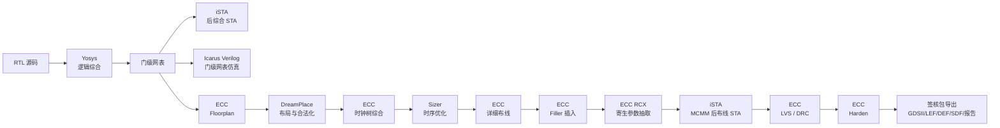

# EDA 工具链与物理设计环境基线报告 (Toolchain Baseline Report)

本文档记录本仓库自带的 EDA 工具链与物理设计环境：容器镜像的构成、各工具的版本与职责、从 RTL 仿真到 GDSII 的流程组成、命令入口、后端工程布局以及时序分析条件。本文只描述工具链本身的设计与使用方式，不包含被测设计的架构与实测数据。

---

## 目录
- [一、运行环境 (Runtime Environment)](#一运行环境-runtime-environment)
  - [1.1 容器镜像 (Docker Image)](#11-容器镜像-docker-image)
  - [1.2 构建与启动 (Build & Launch)](#12-构建与启动-build--launch)
  - [1.3 路径解析与工具覆盖 (Path Resolution)](#13-路径解析与工具覆盖-path-resolution)
- [二、工具版本与职责 (Tool Versions)](#二工具版本与职责-tool-versions)
- [三、流程组成 (Flow Composition)](#三流程组成-flow-composition)
  - [3.1 前端仿真与验证 (Frontend Simulation)](#31-前端仿真与验证-frontend-simulation)
  - [3.2 逻辑综合与静态时序分析 (Synthesis & STA)](#32-逻辑综合与静态时序分析-synthesis--sta)
  - [3.3 后端物理设计 (Physical Design)](#33-后端物理设计-physical-design)
- [四、验证与软件环境 (Verification & Software Environment)](#四验证与软件环境-verification--software-environment)
  - [4.1 NEMU 黄金参考模型与 DiffTest](#41-nemu-黄金参考模型与-difftest)
  - [4.2 抽象机 AM 与运行库 klib](#42-抽象机-am-与运行库-klib)
  - [4.3 Nanos-lite 与 Navy-apps](#43-nanos-lite-与-navy-apps)
  - [4.4 Thread-OS 多任务上下文切换](#44-thread-os-多任务上下文切换)
- [五、命令入口 (Command Entry Points)](#五命令入口-command-entry-points)
  - [5.1 仿真与验证](#51-仿真与验证)
  - [5.2 综合、STA 与后端](#52-综合sta-与后端)
  - [5.3 快速 STA](#53-快速-sta)
- [六、后端工程布局 (Backend Project Layout)](#六后端工程布局-backend-project-layout)
  - [6.1 工程目录](#61-工程目录)
  - [6.2 ecc.toml 字段](#62-ecctoml-字段)
  - [6.3 步骤顺序与旁路](#63-步骤顺序与旁路)
  - [6.4 主要产物](#64-主要产物)
- [七、分析条件 (Analysis Conditions)](#七分析条件-analysis-conditions)
  - [7.1 后综合 STA](#71-后综合-sta)
  - [7.2 后布线 MCMM STA](#72-后布线-mcmm-sta)
  - [7.3 快速 STA](#73-快速-sta)
- [八、约束与使用注意 (Constraints & Notes)](#八约束与使用注意-constraints--notes)

---

## 一、运行环境 (Runtime Environment)

### 1.1 容器镜像 (Docker Image)

仓库内所有实验、构建、仿真、测试、基准与物理设计步骤统一在根目录 [Dockerfile](../../Dockerfile) 构建的 `ysyx` 镜像内执行；宿主机只承担文件编辑与 Git 操作（约束见 [AGENTS.md](../../AGENTS.md)）。

- **基础镜像**：`ubuntu:22.04`，时区 `Asia/Shanghai`，Locale `en_US.UTF-8`。
- **运行用户**：`ysyx`（UID/GID 1000），具备免密 `sudo`，工作目录 `/workspace`。
- **APT 源**：构建参数 `APT_MIRROR` 可覆盖，默认清华镜像。
- **预装组件**：C/C++ 构建链（`build-essential`、`cmake`、`ninja-build`、`autoconf`/`automake`/`libtool`）、RISC-V 交叉编译链（`gcc-riscv64-linux-gnu`）、`python3`、`iverilog`、`yosys`、`gtkwave`、SDL2 运行库、OpenJDK 17、`gtkwave` 等。
- **源码安装组件**：
  - **Verilator**：构建参数 `VERILATOR_VERSION` 指定版本，下载包经 SHA-256 校验后从源码编译，安装到 `/usr/local/bin`。
  - **ECC 工具链**：构建参数 `ECC_VERSION` 指定版本，安装脚本经 SHA-256 校验后以 `--with-toolchain --download-source cnb` 安装到 `~/.local`；安装后执行 `ecc pdk show` 并校验 PDK 关键文件存在，任一步失败即构建失败。
- **环境变量**：

| 变量 | 值 | 作用 |
|---|---|---|
| `YSYX_HOME` | `/workspace` | 工程根目录 |
| `NPC_HOME` | `/workspace/npc` | 处理器 RTL、仿真与后端工程 |
| `NEMU_HOME` | `/workspace/nemu` | DiffTest 参考模型 |
| `AM_HOME` | `/workspace/abstract-machine` | 抽象机与运行库 |
| `NAVY_HOME` | `/workspace/navy-apps` | 用户程序 |
| `ICSPROUT55_HOME` | `/home/ysyx/.local/share/ecc/pdks/icsprout55/v1.10.102` | PDK 根目录 |
| `PATH` | 含 `~/.local/bin` | `ecc` 命令入口 |

### 1.2 构建与启动 (Build & Launch)

```bash
# 构建镜像（首次或修改 Dockerfile 后）
docker build -t ysyx .

# 启动交互式容器，工程目录挂载到 /workspace
docker run --rm -it --net=host -v "$PWD":/workspace ysyx

# 非交互执行单条命令
docker run --rm --net=host -v "$PWD":/workspace -w /workspace ysyx:latest bash -lc 'make test'
```

`--net=host` 用于容器内编译与运行需要网络或本地回环的流程；`/workspace` 为工程根目录，容器内所有命令均在此目录执行。

### 1.3 路径解析与工具覆盖 (Path Resolution)

- **PDK 根目录**解析优先级：`ICSPROUT55_HOME` 环境变量 → `ecc pdk show` 查询结果。两者都为空时，生成的 `ecc.toml` 不写入 PDK 根路径，由 ECC 按 `pdk.name = "ics55"` 自行解析。
- **工具覆盖**：所有工具路径均可通过环境变量或 make 参数覆盖，例如 `make <target> ECC=/custom/ecc ICSPROUT55_HOME=/custom/pdk`。
- **Yosys 来源**：综合流程实际调用的是 ECC 内置的 Yosys（见第二章）；镜像 APT 安装的 `/usr/bin/yosys` 仅作为系统工具存在，不参与 ECC 流程。
- **综合策略**：ABC 策略通过 `YOSYS_SYNTH_STRATEGY` 环境变量传入，Makefile 目标均以该变量显式导出，默认 `DELAY 4`。

---

## 二、工具版本与职责 (Tool Versions)

`ecc version` 输出 ECC 运行时与各后端组件的实际版本；以下版本与本仓库镜像一致。

| 组件 | 版本 | 来源 | 职责 |
|---|---|---|---|
| ECC | 0.1.0a12（安装包 `v0.1.0-alpha.12`） | ECC 安装器 | 物理设计流程编排、workspace/step 管理、报告与签核产物导出 |
| Yosys | 0.68+132 | ECC 内置 | 逻辑综合，RTL → 标准单元门级网表 |
| ecc_tools / iSTA | 0.1.0a13 | ECC 内置 | 后综合与后布线静态时序分析、功耗分析 |
| DreamPlace | 0.1.0a7 | ECC 内置 | 全局布局与合法化 |
| Sizer | 0.1.0-alpha | ECC 内置 | 时序优化（缓冲器插入与门级 sizing） |
| KLayout | 0.30.2 | ECC 内置 | 版图处理与 GDSII 输出 |
| PDK | icsprout55 v1.10.102（`ics55_LLSC_H7C_V1p10C100`） | ECC 安装器 | 55nm 标准单元库、LEF/Liberty、金属互连 RC 技术文件 |
| Verilator | v5.008 | 源码编译 | 周期级 RTL 仿真与 DiffTest |
| Icarus Verilog | 11.0 | APT | 四值仿真与门级网表仿真 |
| GCC (RISC-V 交叉链) | 11.4.0 | APT | 测试程序与基准的交叉编译 |
| Python | 3.10.12 | APT | 流程脚本与报告解析 |
| OpenJDK | 17 | APT | 部分 EDA 组件运行时 |

---

## 三、流程组成 (Flow Composition)

### 3.1 前端仿真与验证 (Frontend Simulation)

- **Verilator 仿真**：`npc/vsrc` 的 RTL 与 `npc/csrc` 的 C++ 测试平台编译为周期级仿真器；检测到 NEMU 参考模型共享库时自动启用 DiffTest 逐指令比对。
- **四值仿真**：Icarus Verilog + `vpi_pmem.vpi` VPI 插件（`npc/csrc/pmem.c`、`npc/csrc/vpi.c`），顶层为 `sim_top.v`，用于检查 X/Z 态传播。
- **门级网表仿真**：Icarus Verilog 加载 Yosys 综合网表与 PDK 标准单元行为模型，验证网表功能一致性。

### 3.2 逻辑综合与静态时序分析 (Synthesis & STA)

- **综合**：Yosys 读取 Liberty 与 RTL，生成门级网表与后综合时序报告；ABC 策略由 `YOSYS_SYNTH_STRATEGY` 控制。
- **后综合 STA**：综合完成后由 iSTA 在固定工艺角下分析，不读 SPEF，采用 ZeroWireload 模型，用于判断关键路径方向。
- **流程预设**：后端工程使用 `rtl2gds` 完整流程；快速迭代使用 `syn_sta` 预设，只包含 `Synthesis` 一步并在综合后执行一次 iSTA。

### 3.3 后端物理设计 (Physical Design)

物理设计流程由 ECC 统一调度，各步骤调用对应工具：



---

## 四、验证与软件环境 (Verification & Software Environment)

前端验证使用的参考模型、运行库、操作系统与应用程序负载统一放在本仓库内，由 Makefile 目标驱动；本章记录其组成与启用方式。

### 4.1 NEMU 黄金参考模型与 DiffTest

- **参考模型**：NEMU 编译为共享库 `riscv32-nemu-interpreter-so`，路径由 `npc/Makefile` 的 `DIFF_REF_SO` 指定；该文件存在时，`make run` 自动附加 `-d` 参数启用 DiffTest。
- **比对方式**：被测核心在每条指令提交时通过 DPI-C 导出寄存器状态，参考模型逐条比对 GPR 与 PC。
- **调试输出**：比对失败时通过 `iringbuf` 打印最近 16 条指令以及软硬件全寄存器差异；日常无错运行保持静默（`g_difftest_ref_mode`），避免日志拖慢仿真。
- **波形**：默认关闭（`--trace` / `--trace-fst` 不启用），需要时由使用方显式开启。

### 4.2 抽象机 AM 与运行库 klib

- **AM 目标平台**：`riscv32e-npc`（RTL 仿真）、`riscv32-nemu`（参考模型）与 `native`；测试与基准通过 `ARCH=<target>` 选择平台。
- **运行库 klib**：提供 `string.h`、`stdio.h`（含 `sprintf`/`printf`）以及 `int64.c` 的 64 位运算模拟，保证同一份 C 程序可在三种目标平台上编译运行。

### 4.3 Nanos-lite 与 Navy-apps

- **Nanos-lite**：简易操作系统，基于 CTE 实现系统调用分发（`SYS_yield`、`SYS_exit`、`SYS_write`、`SYS_read`、`SYS_open`、`SYS_close`、`SYS_lseek`、`SYS_brk`）。
- **VFS**：基于只读 ramdisk 的虚拟文件系统，负责用户程序的定位、打开与加载。
- **用户程序**：Navy-apps 提供 `/bin/hello`、`/bin/dummy` 等 ELF 负载。
- **入口**：`make test-os` 先运行 Thread-OS，再运行 Nanos-lite 的 `/bin/hello`。

### 4.4 Thread-OS 多任务上下文切换

- Thread-OS 是 AM 多任务负载，通过软件主动 `yield()` 触发自陷完成上下文切换：保存 Callee-saved 寄存器现场、重定位栈顶并切换到另一个任务。
- **入口**：`make test-os`，或 `make -C am-kernels/kernels/thread-os run ARCH=<target>`。

---

## 五、命令入口 (Command Entry Points)

所有目标既可在仓库根目录执行，也可通过 `make -C npc` 直接调用子工程目标。

### 5.1 仿真与验证

| 命令 | 作用 |
|---|---|
| `make sim` / `make -C npc sim` | Verilator 编译 RTL 仿真器 |
| `make -C npc run IMG=<bin>` | 运行 Verilator 仿真（NEMU 参考模型存在时自动启用 DiffTest） |
| `make test` | cpu-tests 批量运行（Verilator + DiffTest） |
| `make test-single ALL=<name>` | 运行单个 cpu-test |
| `make -C npc sim-iverilog` | 编译四值仿真程序与 `vpi_pmem.vpi` 插件 |
| `make -C npc run-iverilog IMG=<bin>` | 运行单个四值仿真用例 |
| `make test-4state` / `make test-4state-all` | 运行单个 / 全部四值仿真用例 |
| `make test-os` | 运行 Thread-OS 与 Nanos-lite 工作负载 |
| `make -C npc sim-netlist-iv` | 编译门级网表与标准单元行为模型 |
| `make -C npc run-netlist-iv IMG=<bin>` | 运行门级网表仿真 |

### 5.2 综合、STA 与后端

| 命令 | 作用 | 是否签核 |
|---|---|---|
| `make synth`（等价 `make pnr-synth`） | Yosys 综合 + 后综合 iSTA，输出 QoR 报告 | 否 |
| `make pnr [BACKEND_FREQ_MHZ=<n>] [WORKSPACE=<ws>]` | 一键执行 RTL-to-GDSII 全流程，结束后导出签核包；参数与已生成的工程配置不一致时报错 | 签核产物 |
| `make pnr-status [WORKSPACE=<ws>]` | 每 5 秒刷新并显示各后端步骤的当前状态 | — |
| `make pnr-<step>` | 单步执行：`floorplan`、`place`、`cts`、`legalize`、`opt`、`route`、`filler`、`rcx`、`sta`、`lvs`、`drc`、`harden` | 视步骤而定 |
| `make signoff` | 导出 GDSII、LEF、DEF、SDF、网表与报告 | 签核产物 |
| `make sta-fast [FREQ_MHZ=<n>]` | 快速综合 + 后综合 STA，面向 RTL 迭代 | 否 |
| `make sta-fast-clean` | 清理快速 STA 的工程与运行记录 | — |

### 5.3 快速 STA

`make sta-fast` 只执行综合与后综合 STA，使用独立的工程与 workspace，不影响 `npc/build/backend/` 中的完整流程。参数、产物与验收方法见 [快速 STA 使用说明](001_sta_fast.md)。

```bash
make sta-fast FREQ_MHZ=100
```

---

## 六、后端工程布局 (Backend Project Layout)

### 6.1 工程目录

完整流程与快速 STA 使用互相独立的工程目录：

```text
npc/build/backend/            # 完整 RTL-to-GDSII 工程
├── ecc.toml                  # 设计、PDK 与流程配置
├── project.json              # ECC 工程清单
└── <workspace>/              # 按步骤保存中间结果与报告（默认 default）

npc/build/backend_fast/       # 快速 STA 工程
├── ecc.toml
├── project.json
└── fast/                     # 快速 STA workspace

npc/build/sta_fast/<run_id>/  # 快速 STA 运行记录
├── run.log
├── time.txt
├── summary.txt
└── manifest.json
```

### 6.2 ecc.toml 字段

完整流程的 `ecc.toml` 由 Makefile 生成，固定字段如下：

| 字段 | 值 |
|---|---|
| `design.name` / `design.top` | `cpu_top` |
| `design.clock_port` | `clock` |
| `design.frequency_mhz` | `$(BACKEND_FREQ_MHZ)`，默认 `100.0` |
| `pdk.name` | `ics55` |
| `pdk.root` | `$(ICSPROUT55_HOME)`（为空时不写入） |
| `flow.preset` | `rtl2gds` |

快速 STA 使用同一模板生成 `npc/build/backend_fast/ecc.toml`，`frequency_mhz` 取 `FREQ_MHZ`，`flow.preset` 为 `syn_sta`，workspace 固定为 `fast`。

### 6.3 步骤顺序与旁路

Workspace 内的步骤顺序由 ECC 流程定义：

`Synthesis` → `lec` → `Floorplan` → `place` → `CTS` → `legalization` → `Timing optimization` → `route` → `filler` → `RCX` → `sta` → `lvs` → `postRouteLec` → `drc` → `Harden`

- Makefile 在生成工程时把 `lec` 预置为 `Success`（bypass）。
- `postRouteLec` 检查综合网表与后布线网表的一致性。
- `make pnr` 执行前会校验工程配置：`ecc.toml` 中的 `frequency_mhz` 必须与 `BACKEND_FREQ_MHZ` 一致，`WORKSPACE` 必须已在 `project.json` 中声明；不一致时直接报错，不会按错误配置启动流程。
- 更换频率或工作区时，先删除 `npc/build/backend/ecc.toml` 与 `project.json`，再用新的 `BACKEND_FREQ_MHZ`/`WORKSPACE` 执行 `make pnr`；重新生成的工程会刷新对应工作区。频率变化应配新的 `WORKSPACE`，避免复用旧频率的中间结果。

### 6.4 主要产物

- 综合网表：`<workspace>/Synthesis_yosys/output/cpu_top_Synthesis_sim.v`（保留 `.gz` 压缩副本）
- 综合 QoR 报告：`<workspace>/Synthesis_yosys/report/post_synthesis/qor_summary.rpt`
- 后布线寄生参数与 SDF：由 `RCX`、`sta` 步骤生成
- 签核包：由 `make signoff` 导出，包含 GDSII、LEF、DEF、SDF、网表及各类报告

---

## 七、分析条件 (Analysis Conditions)

### 7.1 后综合 STA

- **工艺角**：单角分析，SS、1.08 V、125 ℃、RCworst（`ICS_N55_H7BR_ss_mos_RCworst_1.08_125`），使用 H7CL/H7CR Liberty。
- **互连模型**：ZeroWireload，不读 SPEF；理想时钟，不约束 I/O 延迟。
- **定位**：用于判断关键路径方向与相对改善，不是签核结论。

### 7.2 后布线 MCMM STA

在由下列维度组合成的 13 个工艺角上进行签核分析：

| 维度 | 取值 |
|---|---|
| 工艺 (Process) | SS/WCL、TT/TYP、FF/MIN、FF/ML |
| 电压 (Voltage) | 1.08 V ~ 1.32 V |
| 温度 (Temperature) | -40 ℃ ~ 125 ℃ |
| 互连 RC (Interconnect) | Cbest、RCbest、TYPICAL、Cworst、RCworst |

寄生参数由 `RCX` 抽取，读取 SPEF 后进行多工况多工艺角分析。

### 7.3 快速 STA

固定 SS 单角，无布局、布线与 RC 抽取，仅综合 + 后综合 STA；只用于迭代阶段判断关键路径方向，结果不代表签核指标。

---

## 八、约束与使用注意 (Constraints & Notes)

- **签核口径**：后综合 STA 使用 ZeroWireload、未插入缓冲树，绝对值偏乐观，不能作为签核结论；是否收敛以后布线 13 角结果为准。
- **流程隔离**：`make sta-fast` 只读写 `npc/build/backend_fast/` 与 `npc/build/sta_fast/`，不会修改完整流程的 `npc/build/backend/`。
- **workspace 复用**：`make pnr` 默认在 `default` workspace 上继续执行；更换频率、工作区或需要干净环境时，先删除 `npc/build/backend/ecc.toml` 与 `project.json`，再以新的参数重新执行。
- **资源占用**：综合、STA 与完整 P&R 的内存和耗时远高于 RTL 仿真，建议单独运行，避免与其他大内存任务并发。
- **签核导出**：`make signoff` 只负责导出产物，不改变流程状态；时序未收敛时导出的仍是未收敛数据。
- **容器约束**：所有实验、构建、仿真、测试与基准必须在容器内执行；宿主机只做文件编辑与 Git 操作。
